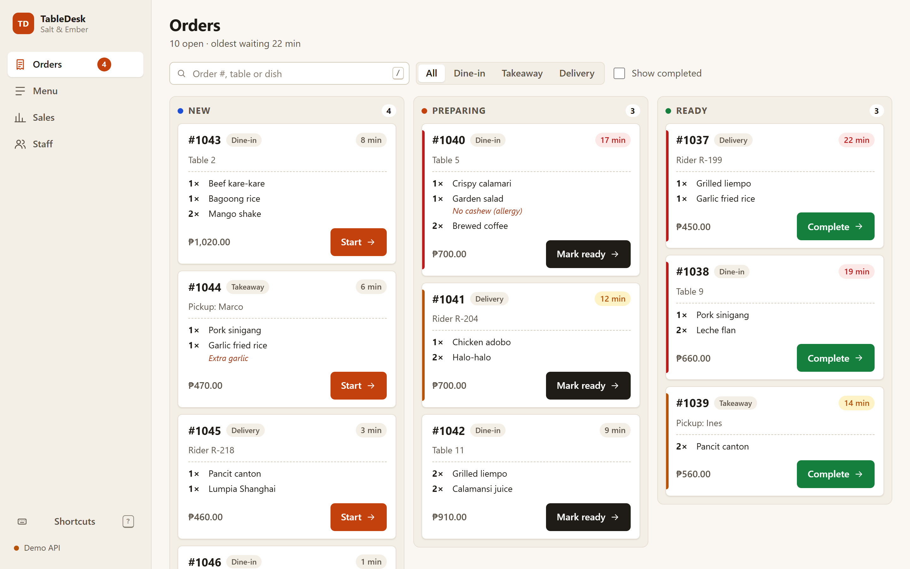
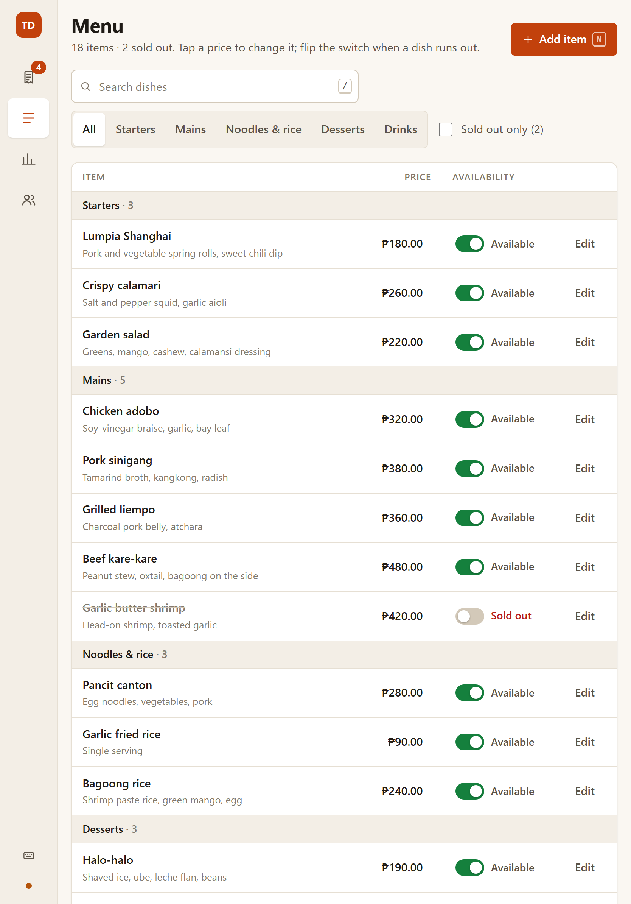

# TableDesk – restaurant admin dashboard

A React + TypeScript admin for a fictional restaurant, **Salt & Ember**: an order
board, menu management, sales summary and staff accounts. It's frontend-only and
talks to a REST API described in [`docs/api.md`](docs/api.md). Without a configured
API it runs against an in-browser mock, so you can open it and click around straight
away.

> Portfolio demo. The restaurant, people and numbers are made up.

| Orders | Menu |
|---|---|
|  |  |

More screenshots (1440 px desktop and 834 px tablet) are in [`showcase/`](showcase).

## Run it

```bash
npm install
npm start          # dev server on http://localhost:5341, opens the browser
```

To use a real backend, copy `.env.example` to `.env` and set `VITE_API_BASE_URL`.
Leave it empty to use the mock.

Try the failure paths with the mock: `/orders?fail=orders` (load error + retry),
`/orders?fail=order-status` (optimistic move rolls back), `/menu?latency=1500`
(loading skeletons). All switches are listed in [`docs/api.md`](docs/api.md).

## Test it

```bash
npx playwright install chromium   # first time only
npm test             # typecheck + production build + Playwright e2e
npm run screenshots  # regenerate showcase/*.png
```

The e2e suite covers the four flows (orders, menu, sales, staff), API errors with
retry, optimistic rollback, form validation (client and server errors), keyboard
use and the tablet layout (44 px targets, no sideways scroll).

## What's inside

- **Stack:** Vite, React 19, TypeScript (strict), React Router, TanStack Query. No UI
  kit; one stylesheet with design tokens (`src/styles.css`).
- **`src/api/`:** typed REST client, query/mutation hooks, shared validation.
- **`src/mocks/`:** MSW handlers that follow the API contract, with fake latency and
  `?fail=` error injection.
- **`src/pages/`:** Orders, Menu, Sales, Staff. Each has loading, empty and error
  states.
- **Keyboard:** `G` then `O/M/S/T` to switch screens, `/` to search, `J/K` and `Enter`
  on the order board, `N` to add, `Z` to undo, `?` for the list.
- **Deploy:** `npm run build:pages` builds for `/table-desk/`;
  `.github/workflows/pages.yml` publishes to GitHub Pages on push to `main`.

## Usability decisions

**1. One tap moves an order forward, and Undo replaces "Are you sure?"**
During a rush, staff move dozens of tickets from New to Preparing to Ready, and a
confirmation dialog on every step would double the taps and train people to click
"Yes" without reading. So each ticket has a single large button for its next step;
the ticket moves instantly (optimistic update), and a toast offers Undo for a few
seconds, or rolls the ticket back with a Retry button if the API rejects the change.
Mistakes stay cheap to fix, while the common path stays fast.

**2. Forms speak up at the right moment and in the right place.**
Errors that appear on every keystroke feel like nagging, but errors that only show
after submit make people hunt for what went wrong. Fields are checked when you leave
them and again on submit; server-side errors (e.g. "this email is already on the
team") appear under the same field as client-side ones, and focus jumps to the first
field that needs fixing. Users get one consistent way of being told what to change,
whether the rule lives in the browser or on the server.

**3. Built for a tablet at the counter, not just a desktop in the office.**
Restaurant admin often happens on an iPad by the pass, with greasy fingers and no
mouse. Below 1100 px (or on any touch screen) every control grows to at least 44 px,
the sidebar collapses to an icon rail that keeps its labels for screen readers, and
tables drop secondary columns instead of scrolling sideways. An automated test
checks the 44 px targets and the absence of horizontal scroll on every screen.
